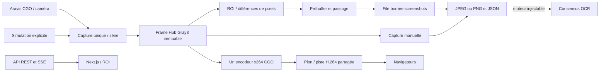

# Architecture V2

## Responsabilités

| Dossier | Responsabilité |
| --- | --- |
| `apps/backend` | Assemblage, cycle de vie, REST et SSE |
| `apps/capture` | Sessions, acquisition unique, mesures |
| `internal/camera` | Interfaces Provider/Device, simulation, Aravis |
| `internal/discovery` | Scans sérialisés, registre des connexions |
| `internal/frames` | Images originales, hub, ring buffer |
| `internal/roi`, `internal/detection` | Validation, masque raster, état de détection |
| `apps/motion` | Worker par caméra, pré/postbuffer et événements |
| `apps/screenshots` | Écriture et index persistants, file hors détection |
| `apps/encoder` | Interface encodeur et implémentation libx264 |
| `internal/stream` | Consommateur H.264 et négociation Pion |
| `apps/ocr` | Interface moteur et consensus remplaçables |
| `internal/config` | Paramètres par série, sauvegarde atomique |
| `apps/web` | Dashboard Next.js et éditeur SVG |

Un seul `go.mod` à la racine. Les modules Go sont des packages dans le même processus ; `camera.Provider`, `camera.Device`, `encoder.Encoder` et `ocr.Engine` définissent les frontières pour une extraction ultérieure. Les dossiers `recording`, `timestamp` et `protocol` restent des points d’extension, sans prétendre implémenter un enregistreur vidéo continu ou une synchronisation matérielle.

## Propriété des images et concurrence

Aravis possède ses buffers réutilisables C. Le pilote copie les pixels et le timestamp matériel dans une image Go, puis restitue immédiatement le buffer C. Une image publiée est immuable. Le hub distribue des références, pas des copies intégrales par consommateur. Son verrou court protège abonnements, publication et fermeture ; les traitements s’exécutent en dehors de ce verrou.

Chaque caméra a ses propres boucles acquisition, détection, écriture screenshots et encodage à la demande. Les files sont bornées. Le détecteur maintient ses masques, sa référence précédente et son état de confirmation dans sa propre goroutine. Une rupture de séquence réinitialise la confirmation. La configuration de ROI est appliquée par révision, sans modifier un masque en cours de lecture.

Les opérations de contrôle du backend sont sérialisées pour empêcher deux ouvertures ou un arrêt pendant une reconfiguration. Cela peut retarder les requêtes de contrôle lors d’une opération matérielle lente, mais ne sérialise pas les acquisitions. Les paramètres matériels sont appliqués acquisition arrêtée, puis relus depuis le périphérique. Un échec tente une restauration ; une erreur persistante du périphérique requiert une reconnexion. Les erreurs matérielles restent visibles dans les logs/statistiques.

Le processus arrête les contextes, termine les workers, vide les files de captures et ferme les ressources. Les clients WebRTC sont bornés et fermés sur échec ou interruption ; les clients sans connexion établie sont nettoyés après 30 secondes. Les clients SSE lents perdent des événements, sans bloquer le pipeline ; les événements caméra périodiques et l’API REST permettent de relire l’état courant.

## Limites explicites

Cette version acquiert uniquement Mono8. Elle ne fournit ni conversion de formats haute profondeur/couleur, ni synchronisation PTP, ni contrôle de bande passante GigE, ni mesure de latence de bout en bout, ni TURN, ni moteur OCR intégré. Le filtrage de mouvement est une comparaison successive de luminance dans un masque ; il faudra régler seuils, cooldown et éclairage sur piste. Une entrée et une sortie d’objet peuvent déclencher séparément si le réarmement est trop rapide.
